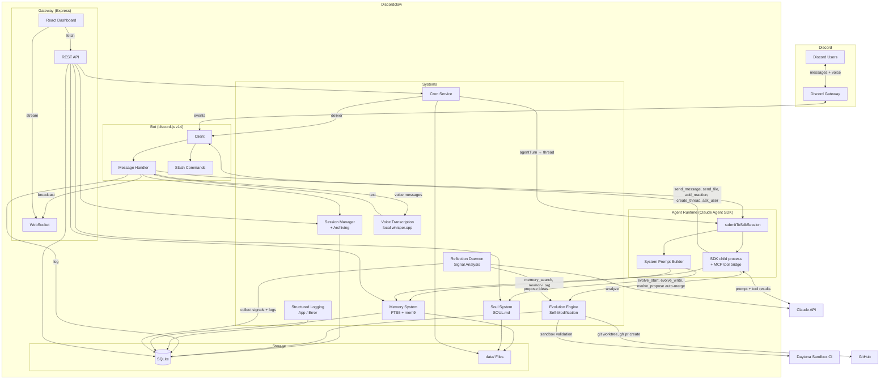
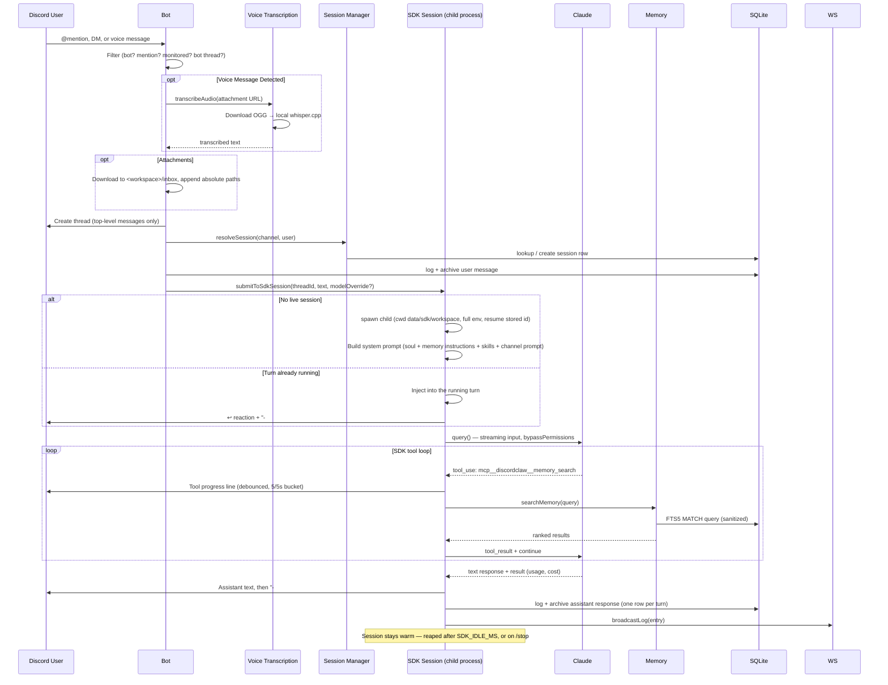
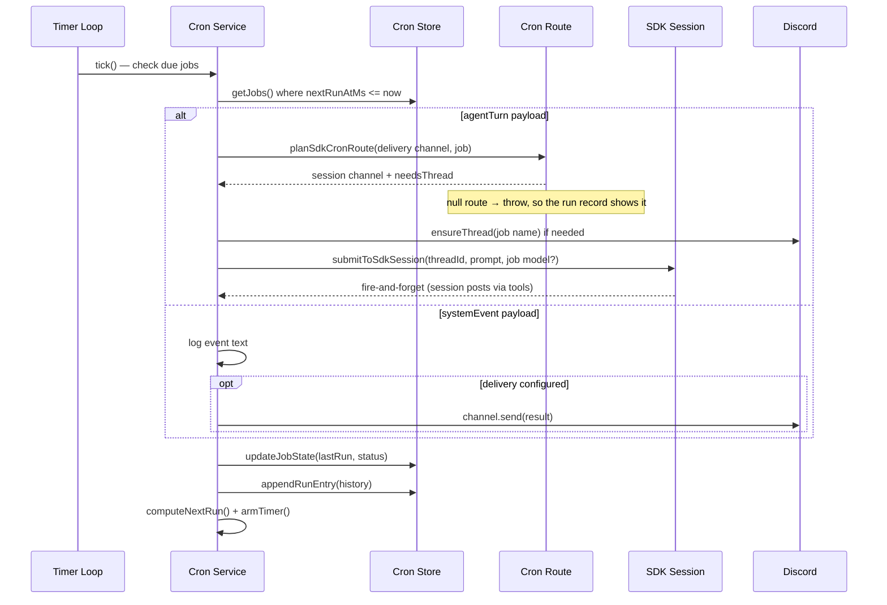
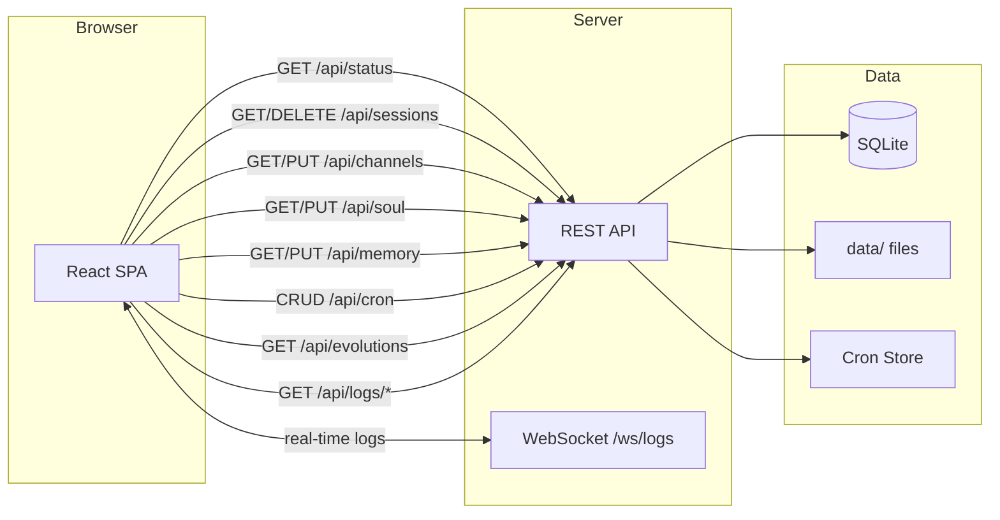
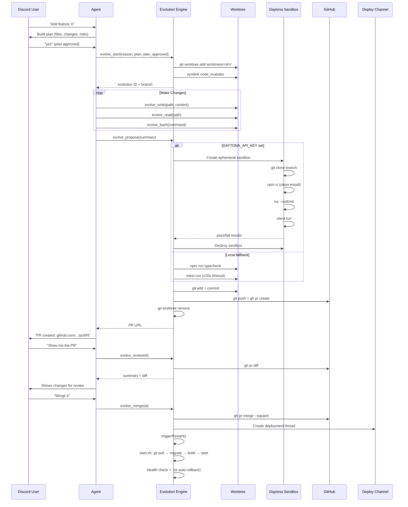

<p align="center">
  
</p>

# Discordclaw

A stripped-down Discord agent powered by Claude. Simplified fork of [openclaw](https://github.com/openclaw/openclaw) — keeps only Discord, replaces multi-provider AI with Anthropic SDK, adds a web dashboard.

## Features

- 💬 **Conversational AI** — @mention in channels or DM directly. Full conversation history per session.
- 🧵 **Thread-First Replies** — In guild channels, every response goes into its own thread for clean session isolation. Monitored channels auto-respond without @mention.
- 🎤 **Voice Message Support** — Send voice DMs and the bot transcribes them automatically, fully offline via whisper.cpp.
- 🧠 **Persistent Memory** — Remembers things across conversations. Markdown files indexed with FTS5 full-text search. Optional mem9 cloud memory for semantic vector search.
- 📜 **Conversation History** — Messages are archived across sessions. Query past conversations with `get_conversation_history` and `get_conversation_stats` tools.
- 🎭 **Customizable Personality** — Edit `SOUL.md` to change how the bot behaves. Hot-reloads on save.
- 🔧 **Tool Use** — Runs shell commands, reads/writes files, sends messages across channels, reacts to messages, attaches files, creates threads. Real-time tool call progress shown in Discord during agentic loops.
- ↩️ **Mid-turn Steering** — A message sent while the bot is still working is injected into the running turn instead of queueing behind it; the bot reacts ↩️ and says which tool it interrupted. `/interrupt` cuts the turn but keeps the session, `/stop` kills it.
- 📦 **Skills** — Drop a `SKILL.md` folder into `data/skills/` and the bot learns new capabilities instantly. Install from GitHub or upload directly.
- ⏰ **Scheduled Tasks** — Cron jobs that run agent turns on a schedule, delivering results in daily threads. Hot-reloads `jobs.json` without restart.
- 🧬 **Self-Evolution** — The bot can modify its own source code via GitHub PRs. You approve the **build plan up front**; once CI passes, the PR is merged and deployed automatically (no diff review step). Optional Daytona sandbox CI for isolated validation. Deployment notifications posted automatically.
- 🔍 **Autonomous Reflection** — Collects signals (errors, tool failures, duplicate loops) and structured logs, then periodically analyzes them to suggest improvements.
- 📊 **Web Dashboard** — React SPA for managing sessions, channels, soul, memory, cron, skills, evolution history, and logs.
- 📝 **Structured Logging** — Two SQLite-backed log streams (application, error) with dashboard viewer and automatic pruning.
- 🔍 **Web Search** — Install the SearXNG skill for web, news, and package repository search.

## Demo User Flow

```
You: Hey @Discordclaw, what did we talk about yesterday?
Bot: [searches memory] We discussed setting up the cron job
     for daily standups. Want me to finish that?

You: Yeah, set it up for 9am every weekday in #general
Bot: [creates cron job] Done! I'll post a standup prompt
     to #general at 9am Mon-Fri. ✅

You: 🎤 [sends voice message]
Bot: [transcribes audio] I heard you say "Can you search
     for the latest Node.js release?" Let me check...
     Node.js v22.5.0 was released on April 1, 2026.

You: Can you search the web for the latest Node.js release?
Bot: [reads searxng-search skill, runs search] Node.js v22.5.0
     was released on April 1, 2026 with...

You: I want you to add a /ping command that shows latency
Bot: Build plan:
     1. src/bot/commands.ts — register /ping, reply with gateway latency
     2. README.md — document the command
     Risk: needs a restart to re-register slash commands. OK to start?

You: yes
Bot: [evolve_start(plan, plan_approved) → evolve_write → evolve_propose]
     PR #8 validated, merged, deploying now... ✅
     /ping command is now live!
```

### Slash Commands

| Command | Description |
|---------|-------------|
| `/ping` | Show bot health status, latency, and uptime |
| `/help` | Show all commands and capabilities |
| `/config` | Toggle bot on/off per channel, set custom instructions |
| `/clear` | Stop this channel's session and drop its context (channel + the threads under it) |
| `/soul` | View the bot's personality |
| `/model` | Show the active model, or switch to another one from the proxy's list (persists across restarts) |
| `/skills` | List, install (from GitHub or file upload), or remove skills |
| `/cron` | View, add, enable/disable, force-run, set a per-job model, or show history of cron jobs |
| `/caveman` | Toggle terse caveman-speak mode (lite/full/ultra/off) for the current channel |
| `/restart` | Restart the bot process |
| `/stop` | Stop every running session (kills the SDK child processes) |
| `/interrupt` | Interrupt the current turn in this channel/thread, keeping the session and its context alive |

## Getting Started

Each instance of Discordclaw is its own bot with its own personality, memory, and evolution history. To run your own, you'll **fork the repo** and deploy from your fork. This way the self-evolution feature creates PRs against *your* repo, not the upstream one.

### Prerequisites

- **Node.js** v20+
- **Git** and **GitHub CLI** (`gh`) — required for the self-evolution engine
- A **Discord bot token** ([setup guide below](#1-create-a-discord-bot))
- An **Anthropic API key** (or a proxy endpoint)
- *(Optional)* A **Daytona API key** for sandbox CI during evolution validation

### 1. Fork & Clone

1. Click **Fork** on [the repo](https://github.com/NaichuanZhang/discord-claw) to create your own copy
2. Clone your fork:

```bash
git clone https://github.com/YOUR_USERNAME/discord-claw.git
cd discord-claw
```

> **Why fork?** The evolution engine pushes branches and creates PRs via `gh`. If you clone without forking, PRs would target the original repo. Your fork gives you full control — the bot evolves *your* codebase.

### 2. Create a Discord Bot

1. Go to https://discord.com/developers/applications
2. Create a new application → **Bot** tab → copy token
3. Enable **Message Content Intent** and **Server Members Intent**
4. **OAuth2 > URL Generator** → scopes: `bot`, `applications.commands`
5. Permissions: Send Messages, Read Message History, Add Reactions, Attach Files, Use Slash Commands, Create Public Threads
6. Invite bot to your server with the generated URL

### 3. Configure Environment

```bash
cp .env.example .env
```

Edit `.env` with your tokens:

```env
DISCORD_BOT_TOKEN=your_discord_bot_token
ANTHROPIC_API_KEY=your_anthropic_api_key

# Optional
GATEWAY_PORT=3000                        # Dashboard port
GATEWAY_TOKEN=your_secret_token          # Dashboard auth token
ANTHROPIC_MODEL=bedrock-claude-opus-5-1m # Fallback model (/model overrides it)
DAYTONA_API_KEY=your_daytona_key        # Sandbox CI for evolution validation
```

### 4. Install & Run

```bash
npm install
npm run build:ui    # Build the dashboard
npm run dev         # Start in development mode
```

The bot responds to **@mentions** in guild channels and all **DMs**. Dashboard at `http://localhost:3000`.

### 5. Production Deployment

For production, use the startup script which handles auto-pull, migrations, health checks, and rollback:

```bash
./start.sh
```

Or use the watchdog daemon for crash recovery and auto-restart:

```bash
npm run daemon
```

You can set up a systemd service, Docker container, or any process manager to keep it running. Point it at `start.sh` or the daemon as the entry point.

> **Tip:** Set `DISCORD_WEBHOOK_URL` in `.env` to receive deploy/rollback notifications in a Discord channel.

### 6. Authenticate GitHub CLI (for Self-Evolution)

The evolution engine uses `gh` to create and merge PRs. Make sure it's authenticated:

```bash
gh auth login
```

Without this, the bot can still function normally — it just won't be able to create PRs to modify its own code.

### 7. Make It Yours

- **Personality** — Edit `data/SOUL.md` to define how your bot talks and behaves. Hot-reloads on save.
- **Skills** — Drop skill folders into `data/skills/` or install from GitHub via the dashboard or `/skills add-github`.
- **Memory** — The bot builds memory over time. You can also seed `data/MEMORY.md` with initial context.

### Staying Up to Date

To pull improvements from the upstream repo into your fork:

```bash
git remote add upstream https://github.com/NaichuanZhang/discord-claw.git
git fetch upstream
git merge upstream/main
```

## Environment Variables

| Variable | Required | Description |
|----------|----------|-------------|
| `DISCORD_BOT_TOKEN` | Yes | Discord bot token |
| `ANTHROPIC_API_KEY` | Yes* | Anthropic API key |
| `ANTHROPIC_BASE_URL` | No | Proxy URL (overrides default API endpoint) |
| `ANTHROPIC_AUTH_TOKEN` | No | Auth token for proxy (used instead of API key) |
| `ANTHROPIC_MODEL` | No | Fallback model name (default: `bedrock-claude-opus-5-1m`). A `/model` selection is stored in the DB and takes precedence. |
| `GATEWAY_PORT` | No | Dashboard port (default: `3000`) |
| `GATEWAY_TOKEN` | No | Auth token for dashboard API access |
| `GATEWAY_PUBLIC_URL` | No | Public URL for the gateway (used for browser live-view links) |
| `SESSION_TTL_HOURS` | No | Session expiry (default: `24`) |
| `DISCORD_WEBHOOK_URL` | No | Webhook for `start.sh` notifications (deploy, rollback alerts) |
| `DAYTONA_API_KEY` | No | Daytona API key for sandbox CI during evolution validation (falls back to local if not set) |
| `DAYTONA_API_URL` | No | Daytona API endpoint (default: `https://app.daytona.io/api`) |
| `REFLECTION_CHANNEL_ID` | No | Discord channel for reflection daemon proposals |
| `REFLECTION_INTERVAL_HOURS` | No | How often the reflection daemon runs (default: `6`) |
| `REFLECTION_LOOKBACK_HOURS` | No | Signal lookback window (default: `24`) |
| `REFLECTION_MIN_SIGNALS` | No | Minimum signals before reflection triggers (default: `3`) |
| `REFLECTION_MODEL` | No | Claude model for reflection analysis (default: same as `ANTHROPIC_MODEL`) |
| `SDK_IDLE_MS` | No | Session idle timeout before teardown (default: `1800000` = 30 min) |
| `SDK_TURN_TIMEOUT_MS` | No | Interrupt a turn that runs longer than this (default: `900000` = 15 min) |
| `SDK_TURN_MAX_COST_USD` | No | Soft cost cap per turn — over it, the usage footer says so. `0` (default) disables the warning |
| `SDK_ATTACHMENT_MAX_BYTES` | No | Per-file cap on attachments downloaded into the session inbox (default: `26214400` = 25 MB) |
| `SDK_INBOX_MAX_AGE_MS` | No | How long downloaded attachments are kept before pruning (default: `86400000` = 24 h) |
| `SDK_ANTHROPIC_API_KEY` | No | Opt into API-key auth for sessions (overrides inherited model auth) |
| `SDK_ANTHROPIC_MODEL` | No | Override the model used by sessions |
| `SDK_ANTHROPIC_BASE_URL` | No | Alternate Anthropic-compatible endpoint for sessions (e.g. a local gateway) |

The `SDK_*` names above are also read under their pre-rename `PILOT_*` spellings, so an existing `.env` keeps working.

*Either `ANTHROPIC_API_KEY` or `ANTHROPIC_BASE_URL` + `ANTHROPIC_AUTH_TOKEN` required.

## Key Systems

**Soul** — Bot personality defined in `data/SOUL.md`. Hot-reloads on file change. Editable via dashboard.

**Memory** — Hybrid search system. Local markdown files in `data/` indexed with SQLite FTS5 (BM25-ranked), plus optional mem9 cloud memory for semantic vector search. Both sources are queried in parallel on every `memory_search` call. Queries are sanitized for FTS5 compatibility (special characters like hyphens and colons are handled automatically).

**Sessions** — Per-thread/DM/channel conversation tracking. The context the model reads lives inside its own SDK child process; our `messages` rows are the durable transcript, archived so `get_conversation_history` and `get_conversation_stats` can query across sessions. Ordering is handled by the session itself rather than a lock: a message arriving mid-turn is injected into the running turn (see Agent Runtime), so nothing has to wait for a mutex.

**Cron** — Scheduled tasks with three schedule types: one-shot (`at`), interval (`every`), cron expression (`cron`). `agentTurn` jobs run the agent and deliver results inside threads (the agent handles all delivery via tools — no duplicate top-level messages). Each one gets a fresh session in a thread of its own, so a scheduled run starts with clean context and a per-job `/cron set-model` override actually applies. `systemEvent` jobs deliver results directly to the configured channel. Auto-disables after 3 consecutive failures. Hot-reloads `jobs.json` on each tick cycle (up to every 60s) so externally-added jobs are picked up without a restart.

**Skills** — Modular capabilities defined as SKILL.md files with YAML frontmatter. Install from GitHub URL or upload directly. Uses SDK progressive loading pattern: only skill metadata (name, description, path) is injected into the system prompt; the agent reads full skill content on demand via `read_skill` tool. Skills can include companion files (scripts, references). Manageable via dashboard and `/skills` command.

**Dashboard** — Single-page React app at `http://localhost:3000`. Pages: Status, Sessions, Channels, Config, Cron, Skills, Evolution, Logs. Real-time message streaming via WebSocket.

**Agent Runtime** — Every message and every scheduled `agentTurn` is handled by a [Claude Agent SDK](https://www.npmjs.com/package/@anthropic-ai/claude-agent-sdk) session (`src/sdk/`) — one child process per Discord thread, DM or channel, keyed by target id. The tool loop, context compaction and duplicate-call handling are the SDK's; what this repo owns is the Discord side of it. See **Agent Sessions** below.

**Thread-First Replies** — In guild text channels, every bot response creates a thread on the user's message. Bot-created threads don't require @mentions for follow-up. Monitored channels auto-respond to all messages without @mention. DMs bypass threading entirely.

**File Attachments** — The agent can send files (PDFs, images, HTML, etc.) to Discord channels via the `send_file` tool. Files up to 25 MB are supported (Discord bot default tier).

**Image Support** — When the agent's response contains markdown images (``), they are automatically extracted and rendered as Discord embeds (for web URLs) or file attachments (for local files). Image markdown is stripped from the text to avoid showing raw URLs.

**Voice Messages** — Discord voice DMs and audio attachments are automatically detected and transcribed, entirely on-device:

- **whisper.cpp** — fully local, a native binary plus a GGML model. Needs no Python, pip, or root, which makes it the only local option on hosts with a broken/absent Python packaging stack. One-time setup: `./scripts/setup-whispercpp.sh` (requires `git`, `cmake`, `g++`, `ffmpeg`). Override paths with `WHISPER_CPP_BIN` / `WHISPER_CPP_MODEL`, thread count with `WHISPER_CPP_THREADS` (default 4).

The transcribed text is passed to the agent as the message content. If whisper.cpp is unavailable the user gets a friendly message and the logs record why (e.g. `whisper.cpp: binary missing at ...`). Supports OGG, MP3, WAV, M4A, WebM, FLAC, and other common audio formats.

**Live voice (archived)** — The v1 voice-channel assistant and the cycling voice coach were removed; the full version lives at the git tag `archive/voice-v1`. `src/voice/` keeps an unwired skeleton (`types.ts` interfaces + `README.md` restore notes) for a future duplex speech-to-speech model.

**Agent Sessions** — Every Discord message and every scheduled `agentTurn` is served by a [Claude Agent SDK](https://www.npmjs.com/package/@anthropic-ai/claude-agent-sdk) session (`src/sdk/`): one child process per target, keyed by thread / DM / channel id. A top-level message spawns a thread via the normal `createThreadForReply` path and the session keys to that **thread**, so each thread is an isolated session with its own context. Sessions are resumed by SDK session id after a restart, reaped after `SDK_IDLE_MS` (default 30 min) idle, killed by `/stop`, and any child that outlives a hard kill is swept at boot by matching its cwd. If a stored session id can no longer be resumed, the session is cleared, whatever the CLI never answered is replayed, and a fresh one starts rather than every later turn failing.

**Mid-conversation injection** — the SDK prompt is an async iterable, so a message arriving mid-turn is handed to the turn already running instead of queueing behind it. When that happens the bot reacts ↩️ on the message and posts a marker line naming the tool it interrupted, so the transcript shows where the course changed.

**Tools** — an in-process MCP server (`createSdkMcpServer`) bridges `send_message`, `send_file`, `add_reaction`, `ask_user`, the memory tools, the context tools `get_channel_history` / `create_thread` / `get_conversation_history` / `get_conversation_stats`, the skill tools `read_skill` / `list_skill_files` (which honour `/skills disable`), and the full `evolve_*` set — so a session self-evolves through the same worktree → PR → CI → auto-merge path, with the plan-approval gate still enforced in code by `evolve_start`.

**No sandbox, by operator choice** — `permissionMode: 'bypassPermissions'` with `allowDangerouslySkipPermissions: true`: no permission prompts, no `canUseTool` gate. cwd is the session's own folder under `data/sdk/workspace/sessions/` but nothing confines a session to it — paths and shell commands are unrestricted (a session can edit `src/**`, read `.env`, run `git push`) — and the child inherits the **full** environment (`src/sdk/env.ts`), so `DISCORD_BOT_TOKEN`, `GH_TOKEN` and every provider key are readable with one `Bash` call. Only convention holds: the system prompt says to route source changes through `evolve_*` — and since `settingSources: ['project']`, the workspace's own `CLAUDE.md` is loaded too, which is where the artifact-placement conventions live (`'user'` is still omitted, so the operator's `~/.claude` settings stay un-inherited). To restore a boundary, filter the child env in `env.ts` and set `permissionMode: 'default'` with a `canUseTool` gate or a `PreToolUse` hook.

**Identity and configuration** — `SOUL.md`, the memory-recall instructions and `/caveman` are injected into the system prompt from `src/shared/prompt-fragments.ts`, and a channel prompt (`/config set-prompt`) goes in under a `## Channel Instructions` heading. Both are read at session start, so a change mid-session applies from the next one (the replies say so with a `-# 🧪` note) and both fall back to the parent channel, since the session lives on a thread while those commands write to the channel above it. `/model` (or a per-job cron model) sets the model a *new* session starts on; `SDK_ANTHROPIC_MODEL` still wins and a running child keeps the model it started with. Model auth arrives with the inherited environment — set `SDK_ANTHROPIC_API_KEY` / `SDK_ANTHROPIC_BASE_URL` to point sessions at a separate key or endpoint.

**Per-session folders.** Each session owns `data/sdk/workspace/sessions/<channel-id>/`, or `sessions/<parent-id>/threads/<thread-id>/` when the session keys to a thread — nested rather than concatenated, because a thread's snowflake is already globally unique so the parent id buys hierarchy rather than uniqueness. Created on session start with a seeded `CLAUDE.md` (session id, parent, status, notes) that is never overwritten, since it outlives the CLI transcript.

**That folder is the session's cwd**, so artifacts land in it by default instead of by convention, attachments download to `<session-folder>/inbox/`, and `CLAUDE.md` discovery walks up — the session's file, the workspace one and the repo one all load. Two consequences were handled with it. The CLI keys transcripts by cwd, so a session id stored before this change points at a directory the CLI no longer reads: `migrateTranscript()` **copies** (never moves) the `.jsonl` and its subagent directory into the new location before a resume, and `session.ts` cross-checks the derived path against `transcript_path` from the init handshake so a wrong derivation is loud rather than silent. And the orphan sweep compares cwd by `root + separator` prefix instead of exactly — every session cwd is now *below* the workspace root, so the old exact match would have swept nothing, while the separator keeps a sibling like `<workspace>-old` from matching.

**Attachments** are handed over as paths, not content blocks: an image or document is downloaded to `data/sdk/workspace/inbox/<messageId>/`, size-capped (`SDK_ATTACHMENT_MAX_BYTES`, default 25 MB) with sanitised filenames, pruned after 24 h (`SDK_INBOX_MAX_AGE_MS`), and its absolute path is appended to the message so the session reads it with its own tools.

**Output and limits** — relayed output goes through a batching queue (`src/sdk/relay-queue.ts`): tool-progress lines are merged on a short debounce and a 5-sends/5s token bucket waits rather than dropping. Each turn ends with a `-# 📊` usage footer (per-turn tokens, cost as the delta of the SDK's cumulative total, latency), a failed tool posts `-# ⚠️ <tool> failed`, and an idle reap says so in the channel. A wedged turn is interrupted by a watchdog (`SDK_TURN_TIMEOUT_MS`, default 15 min) rather than killed, so the session stays resumable and you can just say "continue"; `SDK_TURN_MAX_COST_USD` adds a `-# 💸` line when a single turn passes a soft cost cap. Turns are logged like everything else — the user message and one assistant row per turn go into the normal `messages` tables, so `/history`, the archive, `get_conversation_history` and the log viewer all see them — and a failed turn records an `error` signal for the reflection daemon. `/interrupt` is the softer sibling of `/stop`: scoped to the channel or thread it is used in, it calls the SDK's native `Query.interrupt()`, aborting the running turn but keeping the child and its context, and its reply names the tool that was in flight. It also clears our pending queue; the shipped CLI does not implement `cancel_queued`, so anything already handed over may still run and is reported back once the CLI advertises `interrupt_receipt_v1`. An interrupt is not a rollback — files written and commands run stay. `/clear`, `/stop` and `/restart` act on the whole channel scope (the channel plus live sessions in threads under it), because sessions key to threads while the commands are usually typed in the parent. Known limit: no message-edit streaming.

**Evolution Engine** — The bot can modify its own source code through GitHub pull requests. All changes are isolated in a git worktree at `worktrees/<id>/`, validated, and submitted as PRs via `gh` CLI. Validation runs in two modes: **Daytona Sandbox CI** (preferred) spins up an ephemeral container via `@daytona/sdk`, clones the branch, runs `npm ci`, `tsc --noEmit`, and `vitest run` in full isolation — providing clean CI without interfering with the running bot; **local fallback** runs typecheck and tests in the worktree with symlinked `node_modules` when `DAYTONA_API_KEY` is not set. The agent has 9 evolution tools: `evolve_start`, `evolve_read`, `evolve_write`, `evolve_bash`, `evolve_propose`, `evolve_suggest`, `evolve_cancel`, `evolve_review`, and `evolve_merge`. **The human gate is the build plan, not the diff:** `evolve_start` requires a `plan` plus `plan_approved: true`, so the agent must post its plan and get explicit approval before writing any code. After that, `evolve_propose` validates, opens the PR, merges it (squash), posts a deployment notification thread, and restarts to deploy — fully automatic. Set `EVOLUTION_AUTO_MERGE=false` to restore manual `evolve_review` + `evolve_merge`. If auto-merge fails (merge conflict, GitHub error) the PR is left open and `evolve_merge` is the fallback. The bot also records ideas for improvements it can't yet make (`evolve_suggest`). Evolution history is tracked in SQLite and viewable in the dashboard.

**Structured Logging** — Two SQLite-backed log streams for observability:
- **Application log** (`application_log`): General operational events with level (`debug`, `info`, `warn`, `error`), category, and optional metadata.
- **Error log** (`error_log`): Errors with stack traces, categorized for breakdown analysis.

All logging functions (`appLog()`, `errorLog()`) are non-blocking and never throw — errors during log persistence are silently caught. Use `createLogger(category)` for scoped module loggers. Logs are viewable in the dashboard Logs page and automatically pruned during reflection cycles.

**Reflection System** — Autonomous self-improvement discovery. Two components:
- **Signal collection** (`reflection/signals.ts`): Passively records events — errors, tool failures, duplicate loop patterns. Never throws, ensuring it can't crash the main pipeline. Auto-prunes signals older than 7 days.
- **Reflection daemon** (`reflection/daemon.ts`): Runs on a configurable interval (default: every 6 hours). Gathers signals and structured logs (error breakdowns by category, recent errors), builds a structured analysis prompt, calls Claude, and if an improvement is found, records it as an evolution idea and posts a proposal to a Discord channel. Level 1 trust: never auto-implements — always requires human approval.

**Watchdog Daemon** — Standalone process (`src/daemon/index.ts`) that spawns the bot, monitors health, handles crash recovery with backoff, and sends Discord webhook notifications. Exit code 100 from the bot triggers a deploy-restart (git pull + rebuild) rather than a simple respawn. Zero imports from the main bot.

**Restart** — The bot can restart itself via `/restart` command or automatically after merging an evolution PR. On restart, stale instances are automatically detected and killed to prevent duplicate bots. An idempotent startup script (`start.sh`) handles deploy: `git pull` → run migrations → build → start → health check → auto-rollback on failure.

## Architecture



## Data Flow

### Message Flow



### Cron Job Execution



### Dashboard Data Flow



### Evolution Flow



## Project Structure

```
discordclaw/
├── src/
│   ├── index.ts              # Entry point: start all systems, kill stale instances on restart
│   ├── restart.ts            # Shared restart trigger — avoids circular deps
│   ├── bot/                   # Discord bot (discord.js v14)
│   │   ├── client.ts          # Client setup, intents, event routing, DM raw fallback
│   │   ├── messages.ts        # Message pipeline: filter → voice-message transcribe → thread create → session dispatch
│   │   └── commands.ts        # Slash commands: /ping /help /config /clear /soul /skills /cron /caveman /restart /stop /interrupt
│   ├── agent/                 # Tool definitions + session bookkeeping (bridged into SDK sessions)
│   │   ├── tools.ts           # Discord tools (send_message, send_file, add_reaction, get_channel_history, create_thread, ask_user)
│   │   ├── questions.ts       # Pending ask_user questions (embed + buttons, answer routing)
│   │   ├── tool-paths.ts      # Workspace path resolution for the file tools
│   │   └── sessions.ts        # Per-thread/DM session tracking + TTL + message archiving
│   ├── audio/                 # Voice message handling
│   │   ├── transcribe.ts      # Voice-message transcription (whisper.cpp) + failure diagnostics
│   │   └── whispercpp-transcribe.ts # Local whisper.cpp backend (native binary, no Python)
│   ├── voice/                 # Unwired skeleton for a future duplex voice model (v1: tag archive/voice-v1)
│   │   ├── types.ts           # VoiceTransport / DuplexVoiceModel / DuplexEvent interfaces
│   │   └── README.md          # What v1 had, what to restore, wiring checklist
│   ├── sdk/                   # The agent runtime: one Claude Agent SDK session per thread/DM/channel
│   │   ├── session.ts         # Per-channel SDK session, streaming-input queue, relay, usage footer, resume self-heal, idle reap, orphan sweep
│   │   ├── relay-queue.ts     # Batching send queue: debounced merge + 5-per-5s token bucket (no dropped lines)
│   │   ├── attachments.ts     # Downloads Discord attachments into <session>/inbox and hands over paths
│   │   ├── session-dirs.ts    # Per-session folders + cwd, CLAUDE.md scaffolding, transcript relocation
│   │   ├── bridge.ts          # In-process MCP server re-exporting Discord/memory/skill/history/evolve_* tools
│   │   ├── cron-route.ts      # Routes a cron agentTurn to a session: fresh thread, the thread itself, or the DM
│   │   ├── env.ts             # Child-process env: full inheritance, secrets included (no allowlist)
│   │   └── index.ts           # Public surface
│   ├── logging/               # Structured logging system
│   │   ├── logger.ts          # Core: appLog(), errorLog(), createLogger(category) factory
│   │   └── queries.ts         # Read-side: getAppLogs(), getErrorLogs(), error counts, pruning
│   ├── skills/                # Skills management (SDK pattern)
│   │   ├── types.ts           # Skill, SkillMeta, SkillSource types
│   │   ├── store.ts           # Filesystem-based discovery + per-skill .meta.json
│   │   ├── service.ts         # CRUD, GitHub install, prompt generation, file watcher
│   │   └── tools.ts           # read_skill + list_skill_files tool definitions
│   ├── soul/
│   │   └── soul.ts            # Load SOUL.md, file watcher, hot-reload
│   ├── memory/
│   │   ├── memory.ts          # File discovery, FTS5 indexing, BM25 search, query sanitization
│   │   ├── mem9.ts            # mem9 cloud memory API client (semantic vector search)
│   │   └── tools.ts           # memory_search + memory_get + mem9_store/update/delete tool definitions
│   ├── shared/                # Utilities shared across the runtime, the reflection daemon and the slash commands
│   │   ├── paths.ts           # Project root resolution
│   │   ├── format.ts          # Token/duration formatting for the -# usage footer
│   │   ├── prompt-fragments.ts # Memory-recall + caveman prompt text (system prompt + slash commands)
│   │   ├── anthropic.ts       # Anthropic SDK client factory
│   │   ├── discord-utils.ts   # Channel/guild helpers
│   │   └── conversation-history.ts # Cross-session message loading + conversation history tools
│   ├── cron/
│   │   ├── types.ts           # Job, schedule, payload, delivery types
│   │   ├── store.ts           # JSON persistence + JSONL run history + hot-reload
│   │   └── service.ts         # Timer loop, execution, retry, auto-disable, thread-only delivery for agentTurn
│   ├── reflection/            # Autonomous self-improvement
│   │   ├── signals.ts         # Passive signal collection (errors, tool failures, duplicate loops)
│   │   └── daemon.ts          # Periodic analysis, idea generation, channel proposals
│   ├── evolution/             # Self-evolution system
│   │   ├── engine.ts          # Git worktree lifecycle, PR creation via gh CLI, deployment notifications
│   │   ├── sandbox.ts         # Daytona sandbox CI — ephemeral container validation for evolution branches
│   │   ├── log.ts             # Evolution SQLite table + CRUD
│   │   ├── tools.ts           # Agent tools: evolve_start/read/write/bash/propose/suggest/cancel/review/merge
│   │   └── health.ts          # /api/health endpoint for start.sh
│   ├── daemon/                # Watchdog daemon (standalone process)
│   │   └── index.ts           # Spawns bot, health monitoring, crash recovery with backoff
│   ├── db/
│   │   └── index.ts           # SQLite schema, migrations, query helpers
│   └── gateway/
│       ├── server.ts          # Express + WebSocket server
│       ├── api.ts             # REST API (status, sessions, channels, config, soul, memory, cron, skills, evolutions, logs)
│       └── ui/                # React SPA (Vite)
│           ├── App.tsx         # Layout, routing, shared styles
│           ├── shared.ts       # Shared utilities (colors, apiFetch, formatters) — breaks circular deps
│           └── pages/          # Status, Sessions, Channels, Config, Cron, Skills, Evolution, Logs
├── tests/
│   └── integration/           # Integration tests (vitest)
│       └── boot.test.ts       # Critical boot path: DB, Soul, Memory, Skills, Images, Tools
├── data/                      # Runtime data (gitignored)
│   ├── discordclaw.db         # SQLite database
│   ├── SOUL.md                # Bot personality
│   ├── MEMORY.md              # Long-term memory
│   ├── memory/                # Daily memory notes
│   ├── cron/                  # Job store + run history (jobs.json gitignored, seed file tracked)
│   ├── skills/                # Installed skills (SKILL.md + companion files)
│   └── .migrations/           # Marker files for completed migrations
├── migrations/                # Idempotent migration scripts (run by start.sh)
├── start.sh                   # Production startup: pull → migrate → build → start → health check
├── .env                       # DISCORD_BOT_TOKEN, ANTHROPIC_* config
├── package.json
├── tsconfig.json
└── vite.config.ts
```
